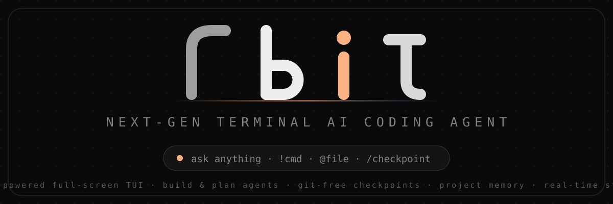
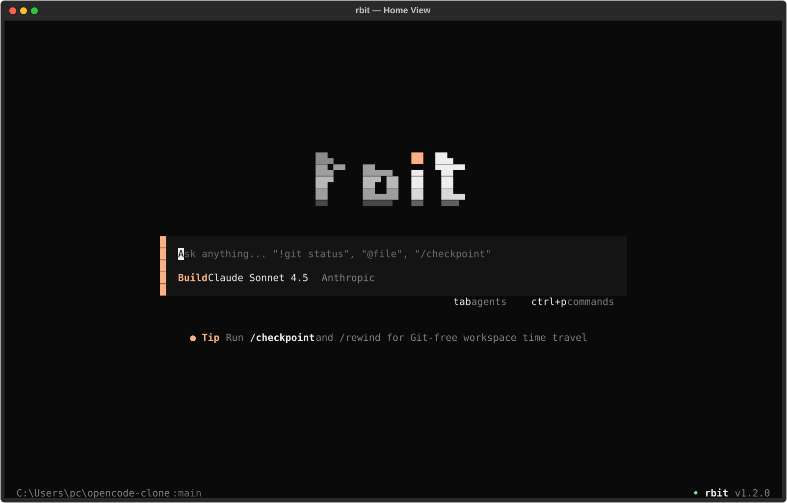
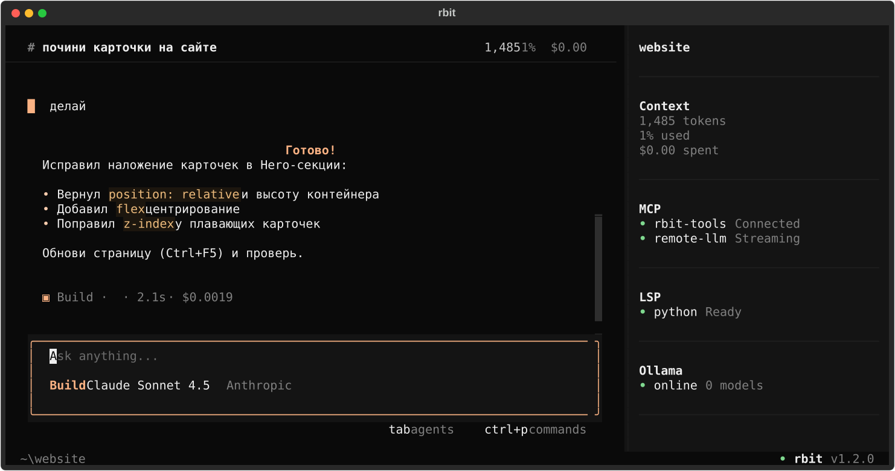
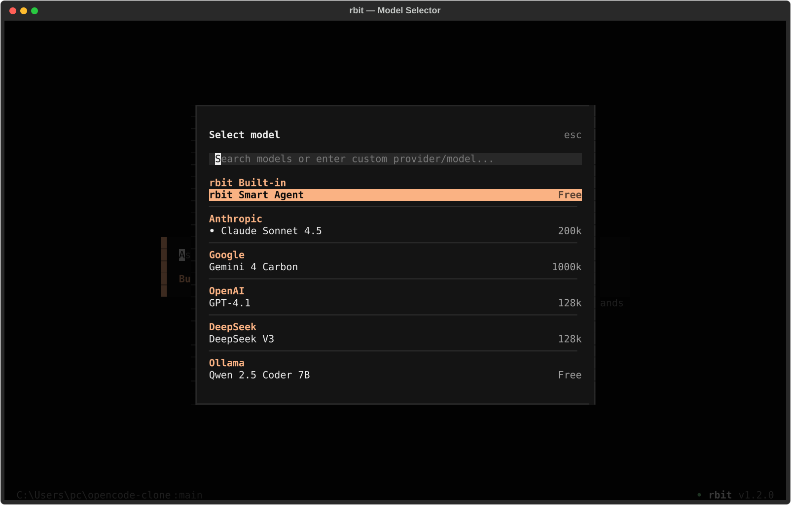

<div align="center">



[](https://www.python.org/)
[](https://textual.textualize.io/)
[](LICENSE)
[](#)
[](tests/test_app.py)
[](https://github.com/DreyzeDev/rbit/actions/workflows/ci.yml)

**Автономный полноэкранный AI-агент для терминала** — редактирует код, ищет по проекту, выполняет команды, хранит память проекта и откатывает время без Git.

</div>

---

## Снимки интерфейса

<div align="center">

<table>
<tr>
<td align="center"><sub><b>Home View</b> — центрированный старт</sub></td>
<td align="center"><sub><b>Agent Session</b> — живой diff карточек</sub></td>
<td align="center"><sub><b>Ctrl+M</b> — выбор модели</sub></td>
</tr>
<tr>
<td></td>
<td></td>
<td></td>
</tr>
</table>

</div>

## Возможности

| | |
|---|---|
| **Полноэкранный TUI** | Тёмный интерфейс на [Textual](https://textual.textualize.io/): Home View, сессии, inline-карточки инструментов с **цветными diff'ами** (зелёные/красные подложки, номера строк) и плоский сайдбар (Context · MCP · LSP · Todo · Files) |
| **Два агента (Tab)** | **Build** — свободно редактирует файлы и запускает команды, **Plan** — только читает, анализирует и составляет план, ничего не меняя |
| **Bang Shell (`!`)** | `!git status`, `!pytest` — команда выполняется мгновенно и **без траты LLM-токенов** |
| **Чекпоинты без Git** | `/checkpoint [имя]` — снимок всего проекта в `.rbit/checkpoints/`, `/rewind` — машина времени в любой момент, даже вне репозитория |
| **Память проекта** | `RBIT.md` + `/remember <правило>` — знания автоматически попадают в системный промпт каждой сессии |
| **Real-time Streaming** | Настоящий SSE-стриминг ответов OpenAI-совместимого API в реальном времени, с повторами на 429/5xx и экспоненциальным backoff |
| **Модели** | OpenRouter / OpenAI / DeepSeek / любой OpenAI-compatible endpoint + автообнаружение локальной **Ollama** (`Ctrl+M`); кастомные заголовки (`extra_headers`); при 401/404 автоматический fallback на `rbit/smart-local` |
| **Инструменты** | `read`, `write`, `edit` (fuzzy fallback), `multi_edit` (атомарно), `glob`, `grep` (контекст, `-l`, лимиты), `symbols` (AST/JS/MD), `git` (status/diff/log/show/blame), `diagnostics`, `lint` (ruff), `webfetch`, `bash`, `todowrite`, `subagent(explore)` + undo/redo стек; `.gitignore` уважается |
| **Виртуальные аттачи** | `@diff`, `@staged`, `@git`, `@tree` — git-diff, staged-изменения, состояние ветки и дерево проекта попадают в контекст без чтения файлов |
| **Команды проекта** | Свои слэш-команды из `.rbit/commands/*.md` с подстановкой `{args}` и автодополнением в палитре |
| **Всё локально** | Сессии, конфиг, память и чекпоинты — в скрытой папке `.rbit/` вашего проекта. Точный подсчёт токенов при установленном `tiktoken` (`pip install -e ".[tokens]"`). Атомарная запись файлов, ротация чекпоинтов (20), лимит чтения 512 KB |
| **Защита от катастроф** | Deny-паттерны для `rm -rf /`, `mkfs`, `diskpart`, `git push --force`, fork bomb и т.п. блокируются до подтверждения |

## Установка

```bash
git clone https://github.com/DreyzeDev/rbit.git
cd rbit
pip install -e .        # ставит команду `rbit` в PATH
```

После установки достаточно набрать `rbit` в любом терминале, из любого каталога.
Для изолированной установки без глобальных зависимостей: `pipx install .`.

Если не хочется ставить в PATH, остаются варианты:

```bash
python -m rbit                          # из исходников
.\rbit.bat                              # Windows-лаунчер (использует .venv)
```

Запуск:

```bash
rbit                                  # TUI по умолчанию
rbit C:\path\to\project               # открыть конкретный воркспейс
```

## Как пользоваться

Единственный ввод — строка приглашения в нижней части экрана:

```
создай файл calc.py с калькулятором     ← обычный промпт агенту
/review src/app.py                      ← анализ файла
!pytest -q                              ← мгновенный шелл без токенов
@src/main.py найди утечку памяти        ← аттач файла к промпту
@diff почему тест падает                ← git-diff прямо в контекст
@tree + @git где точка входа            ← дерево проекта и состояние ветки
```

Свои команды: положите Markdown-файл в `.rbit/commands/`, например
`.rbit/commands/review.md` — и вызывайте его как `/review <аргументы>`
(`{args}` в шаблоне подставится автоматически).

Поддержка провайдеров через `/connect` (Base URL + API key):
`https://openrouter.ai/api/v1` · `https://api.openai.com/v1` · `http://localhost:11434/v1` · любой OpenAI-подобный.
Без ключа работает встроенный локальный Smart-агент `rbit/smart-local`.

## Горячие клавиши

<div align="center">

| Клавиша | Действие |
|---|---|
| `Tab` | Build ↔ Plan |
| `Ctrl+P` / `Ctrl+K` | Палитра команд |
| `Ctrl+M` | Выбор модели |
| `Ctrl+T` | Темы (live preview) |
| `/effort` | Reasoning effort (auto / low / medium / high) |
| `Ctrl+O` | Менеджер Todo |
| `Ctrl+B` | Показать/скрыть сайдбар |
| `Ctrl+N` | Новая сессия |
| `Ctrl+Y` | Скопировать последний ответ |
| `Ctrl+F` | Поиск по сессии (сообщения и вывод инструментов) |
| `Ctrl+X` | Остановить фоновые shell-процессы |
| `Ctrl+E` | Свернуть все карточки инструментов |
| `F1` | Шпаргалка по клавишам и командам |
| `!` + строка | Мгновенный шелл (без токенов) |
| `Esc` | Прервать агента (частичный ответ сохраняется как `interrupted`) |
| `Ctrl+Q` | Выход |

</div>

## Слэш-команды

```
/checkpoint [имя]     Снимок проекта (без Git)      /rewind    Откат к снимку
/remember <правило>   Память проекта               /export    Экспорт сессии в Markdown
/todo [задача]        Чеклист                       /undo      Отменить правку файлов
/doctor               Диагностика (API, Ollama...)  /redo      Вернуть отменённое
/model · /theme       Модель и тема                 /compact   Сжать контекст (LLM)
/init                 Анализ проекта + план         /fork [N]  Ветка сессии от сообщения N
/retry                Повторить последний промпт    /commit    Черновик коммита по diff
/copy                 Скопировать последний ответ    /diff      Сводка изменений
/search <запрос>      Поиск по сессии                  /todo      Чеклист задач
/help                 Горячие клавиши и команды     /effort    Reasoning effort (o-серия / R1)
```

## CLI (headless / CI)

```bash
rbit run "исправь flake8-предупреждения"      # выполнить задачу без TUI
rbit run --stdin "ревью этого diff" < diff.txt
rbit run --json "..."                         # структурированный JSON-вывод для CI
rbit run --output-format jsonl "..."          # событийный поток tool_call/message/done
rbit commit [dir]                             # черновик сообщения коммита (--apply)
rbit update [--check] [--json]                # проверка/установка новой версии с PyPI
rbit --generate-completion bash|zsh|powershell  # скрипт автодополнения
rbit --profile work run "..."                 # оверлей настроек из config.json
rbit --effort high run "..."                  # reasoning effort для reasoning-моделей
rbit --allow-outside run "..."                # разрешить доступ к путям вне workspace
rbit doctor                                   # диагностика окружения
rbit stats                                    # аналитика токенов и расходов
rbit sessions                                 # список сохранённых сессий
rbit init                                      # создать RBIT.md и .rbit/memory.md
rbit sessions --prune 30d                      # удалить сессии/чекпоинты старше 30 дней
rbit export -o report.md                      # выгрузить переписку в Markdown
rbit map                                      # карта проекта: файлы, языки, бюджет токенов
rbit map --json --max-tokens 4000             # структурированный вывод для CI
rbit lint                                     # ruff (или встроенные диагностики); exit 1 при ошибках
rbit lint --json                              # JSON-отчёт для CI
```

## Тесты

```bash
.venv\Scripts\pytest -v
```

Headless-тесты прогоняют настоящий TUI через Textual Pilot: Home→Session переходы,
Todo-лист, diff-карточки, undo/redo, чекпоинты, память проекта, модалки и CLI-подкоманды.

## Структура проекта

```
rbit/
├── app.py         # Полноэкранное TUI-приложение (Home / Session / Bang Shell)
├── cli.py         # CLI: run · doctor · stats · sessions · export · map · lint · init
├── agent.py       # Движок: SSE-стриминг, Ollama discovery, Smart-агент
├── tools.py       # Инструменты агента + чекпоинты + undo/redo
├── storage.py     # Сессии, конфиг, память, чекпоинты, экспорт
├── widgets.py     # Карточки, логотип, сайдбар, автодополнение
├── modals.py      # Командная палитра, модели, темы, чекпоинты, Todo
├── models.py      # Структуры данных (Session, ChatMessage, ToolCall...)
├── themes.py      # Темы оформления
└── __main__.py    # python -m rbit
```

## Дорожная карта

Актуальный приоритизированный бэклог — в [docs/IMPROVEMENTS.md](docs/IMPROVEMENTS.md).

- [x] Real-time SSE-стриминг
- [x] Чекпоинты без Git + `/rewind`
- [x] Проектная память (`RBIT.md`, `/remember`)
- [x] Параллельные read-only инструменты и авто-диагностика
- [x] Секрет-гард и авто-чекпоинты перед правками
- [x] Виртуальные аттачи `@diff`/`@git`/`@staged`/`@tree` и команды проекта
- [x] Суб-агент `subagent(explore)`
- [x] Умная компакция контекста, `/retry` и `/fork`
- [x] `rbit map` и инструмент `lint` (ruff с fallback на AST)
- [x] Точный подсчёт токенов (`tiktoken`), retry/backoff на 429/5xx, `/commit`
- [x] CI: GitHub Actions — `pytest` + `ruff` на каждый push
- [x] `.gitignore` для `glob`/`grep`, fuzzy-`edit`, контекстный `grep`, `rbit lint`
- [x] Deny-паттерны для катастрофических shell-команд
- [x] `symbols`, read-only `git`, `/copy`, `rbit init`, `sessions --prune`
- [x] Fallback на smart-local, `run --stdin`, атомарная запись, лимиты чтения и чекпоинтов, ANSI-санитайз
- [x] Компактный режим (<100 колонок), тема high contrast, `rbit commit`, JSONL-поток, shell completion
- [x] Индикатор Ollama в сайдбаре, экран помощи `F1`, флаги `--quiet/--verbose/--trace`, pre-commit
- [x] `bash` timeout/background, читаемый `webfetch`, ripgrep-grep, профили `--profile`, изолированный conftest
- [x] Кэш списка файлов, keep-alive пул `httpx`, проверка ключа в `/connect`, недавние в палитре, community-доки
- [x] Импорт всех моделей провайдера в отдельную категорию при `/connect`
- [x] Автопоиск моделей: кэш в конфиге, фоновое обновление при старте, `/connect` и открытии селектора
- [x] Выбор reasoning effort (`/effort`, `--effort`) для o-серии, DeepSeek R и thinking-моделей
- [x] `apply_patch` (unified diff), кнопка stop для фоновых `bash`, поиск по сессии (`Ctrl+F`)
- [x] `rbit update` (PyPI), единый источник правды для Todo (todowrite ↔ сайдбар)
- [x] Сохранение частичного ответа при `Esc`, `Enter`/`Ctrl+E` для карточек, «прилипающая» прокрутка
- [x] Дебаунс записи сессии, запрет путей вне workspace (`--allow-outside`)
- [x] Бюджет хода (`max_steps`, `max_cost_usd`), восстановление после краха, ленивый рендер истории
- [x] Копирование пути/команды правым кликом, retry (`Ctrl+R`) с подсказками при ошибках API

## Лицензия

[MIT](LICENSE) © [DreyzeDev](https://github.com/DreyzeDev)

---

<div align="center">
<sub>Сделано на <a href="https://textual.textualize.io/">Textual</a> · <a href="https://github.com/DreyzeDev/rbit">поставь звезду, если пригодилось</a></sub>
</div>
